<p align="center">
  
</p>

<h1 align="center">HyperGym</h1>

<p align="center">
  <strong>小米手环 10 Pro × 小米手机的力量训练追踪系统</strong><br>
  手环上记录每一组，手机上看到每一天
</p>

<p align="center">
  
  
  
  
  
  
  
</p>

---

## 目录

|  |  |  |
|---|---|---|
| [界面预览](#界面预览) | [这是什么？](#这是什么) | [功能特性](#功能特性) |
| [手环端界面](#手环端界面vela-快应用) | [系统架构](#系统架构) | [技术栈](#技术栈) |
| [项目结构](#项目结构) | [快速开始](#快速开始) | [数据流详解](#数据流详解) |
| [手环内置动作](#手环内置动作28-个) | [设计语言](#设计语言) | [应用图标](#应用图标) |
| [更新记录](#更新记录) | [已知问题](#已知问题) | [许可证](#许可证) |

---

## 界面预览

<table>
<tr>
  <td>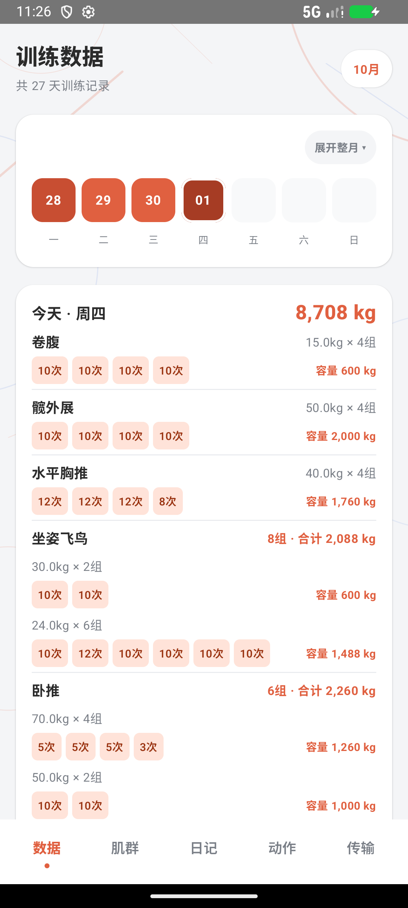</td>
  <td>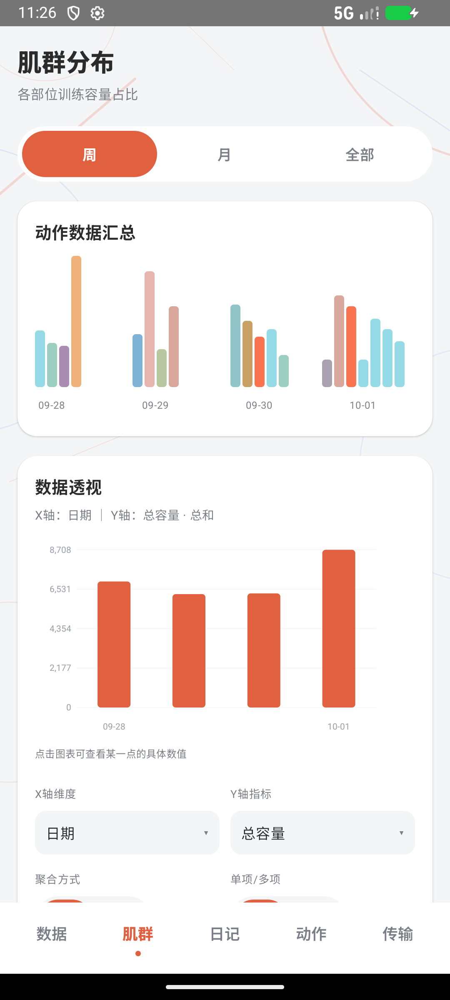</td>
  <td>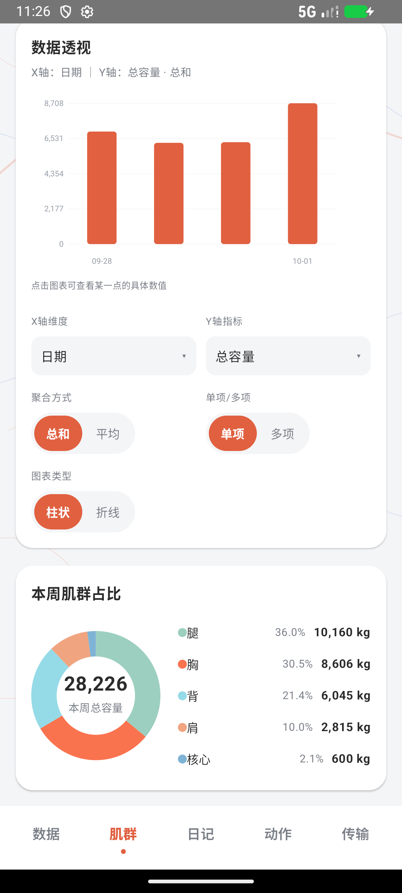</td>
</tr>
<tr>
  <td align="center">数据总览</td>
  <td align="center">肌群分析 · 动作汇总 + 数据透视</td>
  <td align="center">肌群分析 · 透视卡片 + 肌群占比</td>
</tr>
<tr>
  <td>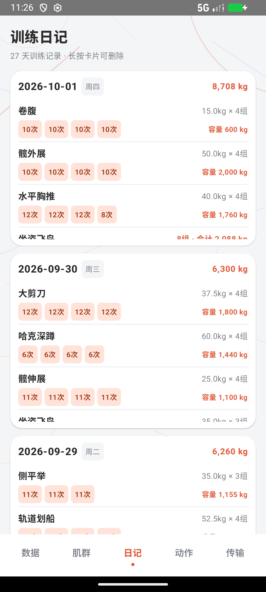</td>
  <td>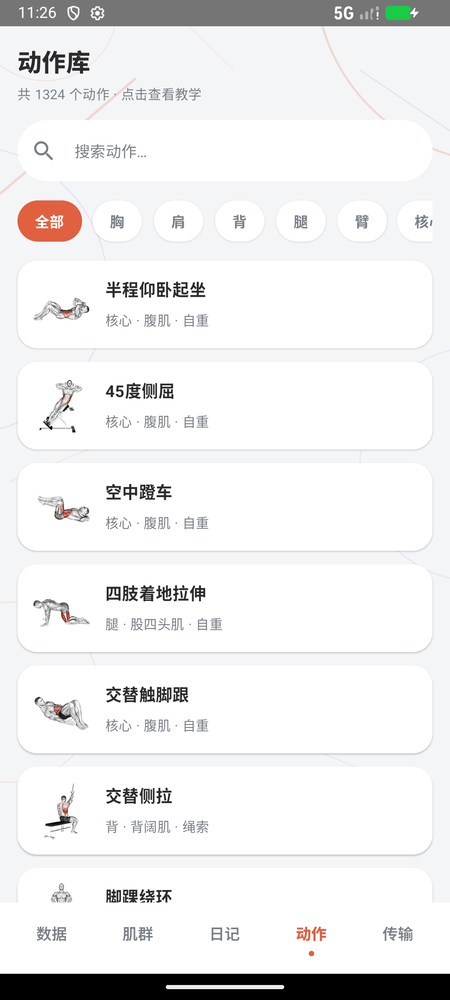</td>
  <td>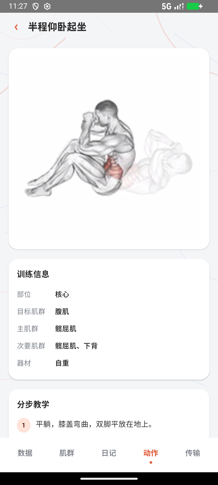</td>
</tr>
<tr>
  <td align="center">训练日记</td>
  <td align="center">动作库（1324 个动作）</td>
  <td align="center">动作详情（教学 + 视频）</td>
</tr>
<tr>
  <td>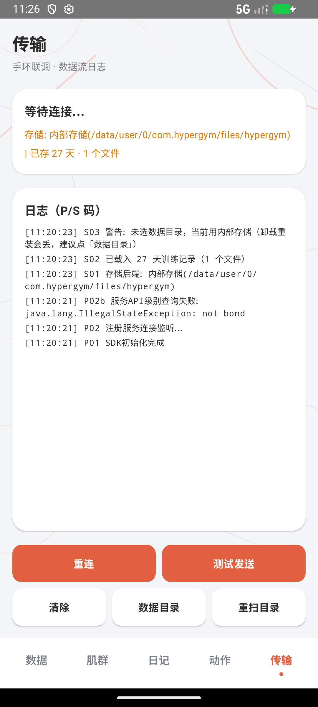</td>
  <td colspan="2" align="center">传输页（手环联调 · 数据流日志）</td>
</tr>
</table>

> 截图来自 Android 模拟器（1080×2400 / 420dpi，App v3.1.18，内置示例训练数据），UI 为「暖橙 + 白卡 + 柔和阴影」风格。

---

## 这是什么？

HyperGym 是一套**手环 + 手机**协同的力量训练记录系统：

- **手环端**（小米手环 10 Pro / Vela OS）：在手环上选择动作、记录每组重量和次数，长按历史记录一键发送到手机。
- **手机端**（Android / HyperOS）：接收数据后，以暖橙白卡风格的现代 UI 展示训练统计、肌群分布、训练日记和 1324 个标准动作的教学库。

当前版本：**手机端 v3.1.18**（versionCode 25） / **手环端 v1.0.70**（versionCode 70），底部 5 个页签：**数据 / 肌群 / 日记 / 动作 / 传输**。

> ⚠️ **手环 rpk 的签名方式已定死，禁止修改。**
> 一旦 rpk 的签名与手机 APK 不一致，两个设备会**彻底无法通信**，而且这个问题**不留任何源码痕迹**。
> 动手前请先读 [`SIGNING.md`](SIGNING.md)。

`demo-package/` 下是本机打好的安装包（**不入库**，见 `.gitignore`）：`HyperGym-release.rpk`（手环）、`HyperGym-Phone-debug.apk`（手机）。用根目录的 `build-debug.ps1` 一键重新产出。
---

## 功能特性

### 📊 数据总览（数据页）


- **训练热力图**：周历 + 「展开整月」月历网格。色阶按**名次**分 4 档**实色**（不是"当天 ÷ 最大值"），所以即使各天数据很接近也能一眼看出多少——否则只要有一天特别猛，其余天就全被压成同一片浅色。未训练用**冷灰**、已训练用**暖橙**，靠**色相**区分而不只是明暗。卡片内只有热力图本身，不加任何说明文字。
  - **收起时是一整周（周一→周日）**，取**今天所在的那一周**——和展开后的月历同一套列排布，
    所以收起/展开看到的是同一周，不会出现"收起显示上周、展开显示本周"的错位
  - 今天**之后**的格子沿用月历口径：**灰块占位、不写日期、不可点**（未来的日子没有数据可看）
  - 展开态左上角还有 **‹ 年月 › 左右翻月**；今天用主色描边、点选的那天用白色描边
- **页头**：标题 + 「共 N 天训练记录」；右上角月份 pill 点开是**横向滚动的月份选择器**——
  选某个月会同时把区间切到「月」、展开月历、并把该月最后一天设为选中日。
- **当天训练卡片**：展示所选日期的动作明细 + 当日总容量。**同一动作的不同重量合并在一块**——动作名只出现一次，组内按重量分行（每行左侧重量、右侧该重量的容量，下方是该重量的次数标签），右侧给出该动作的组数与合计容量，不再重复占行。
- **PR 纪录卡片**（在「当天训练卡片」下方）：列出**每个动作的历史最高重量**，并换算成可直接上杠的配重。
  - **肌群可折叠**（默认全部收起）：收起时每个肌群一行 —— `色点 + 肌群名 + 动作数 + ▸`，整张卡片约 240px；
    点某一行才展开它下面的动作，**可同时展开多个**
  - 展开后**每个动作一行**，动作行只用**肌群色点**标识归属、不重复写肌群名；组内按**重量降序**
  - 每行两个数字：**PR**（主题橙）与**实际用**（主文字色/黑），两者之间留 **10dp 固定间隙**——
    这是两类量纲不同的数（前者是历史最高，后者是今天该上的配重），范围文字最长（如 `52.5–55.0kg`）时也不能贴在一起
  - **实际用** = `PR × 下限%` 与 `PR × 上限%`，各自取到最近的 **2.5kg**（四舍五入，杠铃片最小组合单位），
    两端相同则只显示一个值；结果固定 **1 位小数**，所以只会出现 `.0` / `.5`（如 `50.0–52.5kg`）
  - 卡片右上角两个**百分比输入框**（默认 65 / 70）可手输，改完下面所有数字立即重算；
    该设置**持久保存**（SharedPreferences），重开 App 仍是上次输入的值
  - **只显示有配重的动作**：自重（0kg）按口径不算 PR，因此不出现
  - 始终基于**全部历史**，不随页面上方的「周 / 月 / 全部」变化

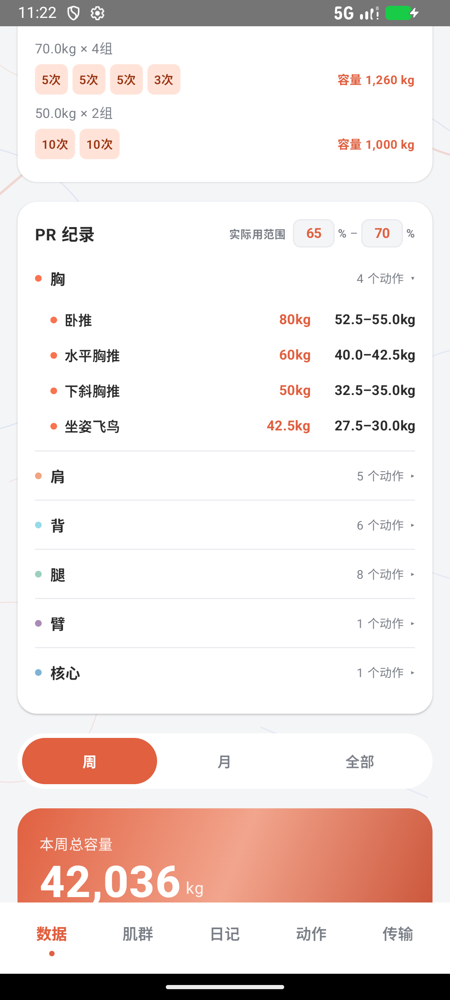

> 点肌群行展开该肌群的每个动作：左边橙色是该动作的历史最高（PR），右边黑色是
> `PR × 65%~70%` 换算出的实际用范围（各自取到最近的 2.5kg）。两个数字之间留 10dp 固定间隙。

- **范围切换**（pills 位于 PR 卡之后）：**周 / 月 / 全部**，切换英雄卡、统计卡与容量趋势。三档的实际口径：

  | 档位 | 取数范围 | 说明 |
  |---|---|---|
  | 周 | **最近 7 天**（今天往前数 7 天） | ⚠️ **不是自然周**，但英雄卡标题写的是「本周总容量」（见[已知问题](#已知问题)） |
  | 月 | 所选月份的 **1 号 → 今天** | 月份由页头右上角的月份 pill 切换，可选历史月份 |
  | 全部 | 全部历史 | — |

  环比也是按同一口径取上期：周 = 近 7 天 vs 前 7 天；月 = 本月 vs 上月同期；全部 = 最近 4 周 vs 再前 4 周。
- **英雄卡**：总容量（标题随档位变为「本周 / X月 / 累计总容量」）+ 环比 ↑/↓% + 「N 次训练」。
- **统计卡片**：两张 —— **训练次数**、**总组数**。
- **容量趋势卡**：容量柱状图，横向可滚动、**默认滚到最右端**（优先显示最近的数据），柱顶标数值。

### 💪 肌群分析（肌群页）


- **动作数据汇总**：按天分组的**细柱状图**，同一天不同动作不同色；**默认滚动到最右端**（优先显示最近几天，而不是最早的几天）；**点击某一天的柱状图**，卡片底部按当天数据显示图例（可换行，两行内完整展示），再点可收起。
- **数据透视卡片**（页面第 2 张卡，可自定义）：像数据透视表一样组合维度与指标——
  - **X轴维度**：日期 / 周 / 肌群 / 动作
  - **Y轴指标**：总容量 / 总组数 / 总次数 / 平均重量 / 平均次数
  - **聚合方式**：总和 / 平均
  - **单项 / 多项**：单项显示一条汇总序列；多项按「明细维度」（动作 / 肌群）拆成多条彩色序列
  - **图表类型**：柱状 / 折线，**柱从底部生长、折线从左向右展开**的微动画
  - **横轴只标首尾两个日期**：数据一多逐点标注会全部挤在一起，中间的点改为点击查看
  - **点击图上任意一根柱/点**：下方直接列出该点各序列的数值（再点一次取消选中），并在图上高亮该点的竖线与圆点
  - **默认显示最近的数据**：数据变化后自动滚到最右端
  - **图例可点选筛选**：点图例里的某一项只看该序列（再点取消），卡片上会标出「已筛选：X」
  - X / Y 轴是**下拉菜单**，聚合方式 / 单项多项 / 图表类型是**分段 pill**


- **区间切换**（在页头下方、所有卡片之前）：**周 / 月 / 全部**，按**自然周期**取——**周 = 本周一 ~ 周日**，**月 = 本月整月**，**全部 = 全部历史数据**。选「全部」时，下面的数据透视与肌群占比都改用全部数据一起分析。
- **肌群占比**：甜甜圈图（中心显示区间总容量）+ 各肌群占比清单（百分比 + 容量）；
  标题随区间变为「本周 / 本月 / 全部肌群占比」。
  配色用的是**手环那套部位色**（`GROUP_COLORS` —— 胸橙 / 肩浅橙 / 背天蓝 / 腿柔绿 / 臂淡紫 / 核心蓝），
  与上面两张卡片的 `ChartPalette` 不是同一套：占比按**部位**上色，颜色和数据页 PR 卡片的色点一致。

### 📖 训练日记（日记页）


- 按日期倒序展示每天训练详情，每张卡片固定 **216dp 高的明细区**（约 3 个动作的高度），超出部分**卡片内上下滚动**。
- 与数据页保持一致：**同一动作的不同重量合并在一块**显示，动作名不再重复出现。
- **PR（个人纪录）徽章**（`🏆 动作名 值kg`）自动识别并标记 —— 只标**打破此前纪录**的那一天，**首次记录不算 PR**。
- **长按卡片晃动 + 右上角红色 ✕**：进入删除态的卡片会轻微摇晃（±2°）并显示 26dp 的红色 ✕；
  再长按一次或点卡片退出删除态。⚠️ **点 ✕ 立即删除、没有二次确认**。
  删除后**数据 / 肌群 / 日记页联动刷新**，对应日期的 JSON 行也从 `records-NNNN.jsonl` 数据文件中同步移除。

### 🏋️ 动作库（动作页）


- 内置 **1324 个标准健身动作**（**纯中文**名称 + 分步教学 + 演示视频 + 图示），与手环动作列表**完全解耦**。
- 支持按肌群分类筛选（全部 / 胸 / 肩 / 背 / 腿 / 臂 / 核心 / 有氧 / 颈）+ 关键词搜索（按名称包含、不区分大小写）。
  列表项左侧是 56dp 缩略图，右侧是「分组 · 目标肌群 · 器材」。
  > 分类里还会产出「**其他**」，但筛选条里没有这一项 —— 这类动作只在「全部」下出现。
- 点击动作进入详情（同页切换）：**训练信息**（部位 / 目标肌群 / 主肌群 / 次要肌群 / 器材）+ **分步教学** + **1:1 方形视频演示**（ExoPlayer 本地 mp4 单曲循环、无控制器、无声自动播放）。


### 📡 数据传输（传输页，原「诊断」）


- 蓝牙连接状态实时显示。
- **P/S 调试码日志**，方便排查：**P 码 20 个（P01–P19，含 P02b）** 是互联链路，
  **S 码 9 个（S01–S08，含 S02r）** 是本地存储（后端 / 载入 / 落盘 / 删除）。
  两组逐条对照见 [`INTERCONNECT-GUIDE.md`](INTERCONNECT-GUIDE.md) §5。
- **SAF 安全目录存储**（卸载重装数据不丢）为主，内部存储兜底。
- 操作按钮：重连 / 测试发送（主色一行），清除 / 数据目录 / 重扫目录（白卡一行）。
  > **「清除」只清界面上的原始消息缓存，不会删除任何训练数据文件。**

---

## 手环端界面（Vela 快应用）

手环端为 `miband10pro-trainer`（Vela OS 快应用，`com.hypergym`，versionName **1.0.70**，versionCode 70）。主界面是一个横向滑动容器，**左右滑动切换 5 屏**。

<table>
<tr>
  <td>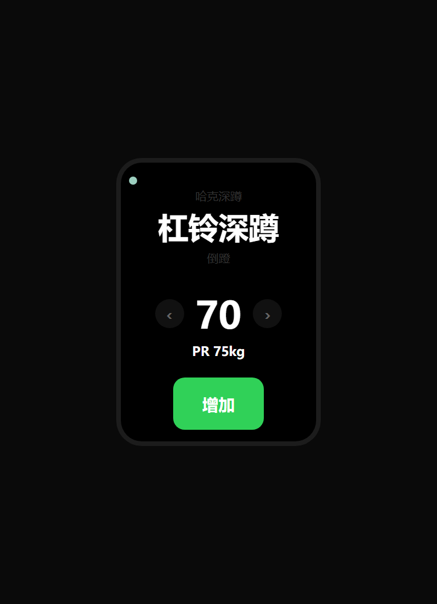</td>
  <td>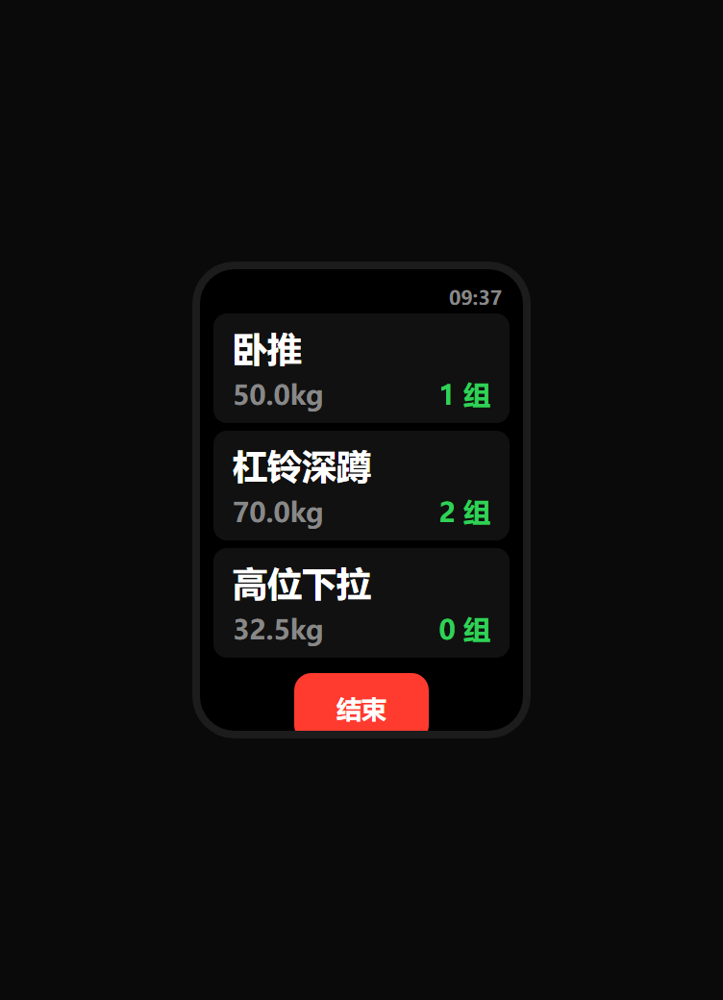</td>
  <td>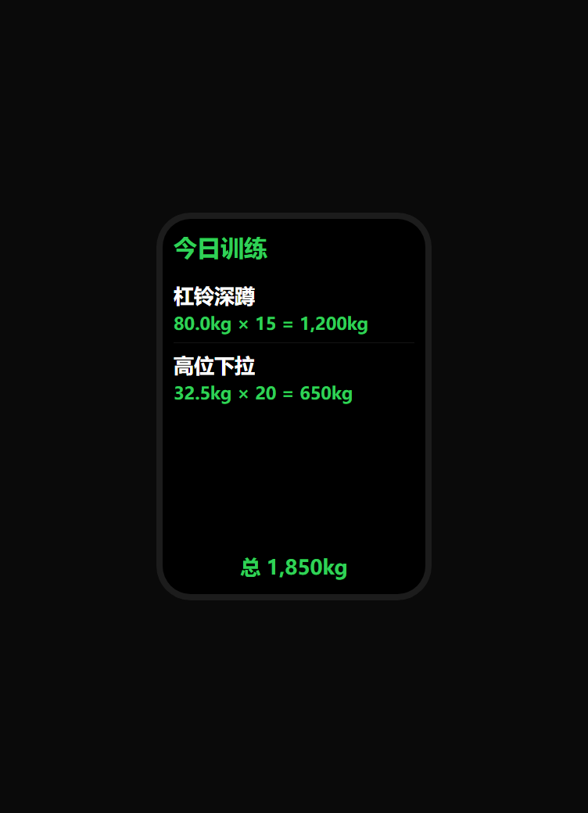</td>
</tr>
<tr>
  <td align="center">屏0 · 计划</td>
  <td align="center">屏1 · 记录列表</td>
  <td align="center">屏2 · 今日数据</td>
</tr>
<tr>
  <td>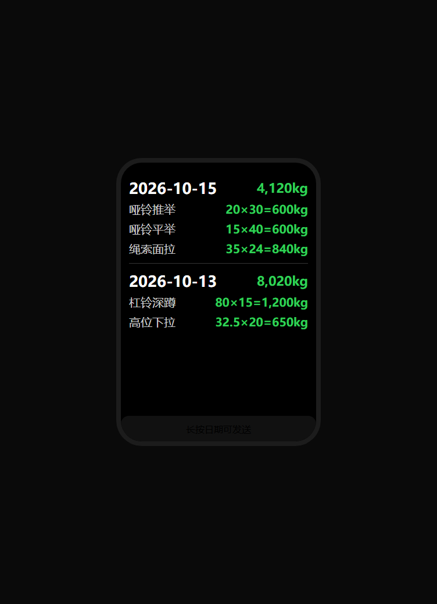</td>
  <td>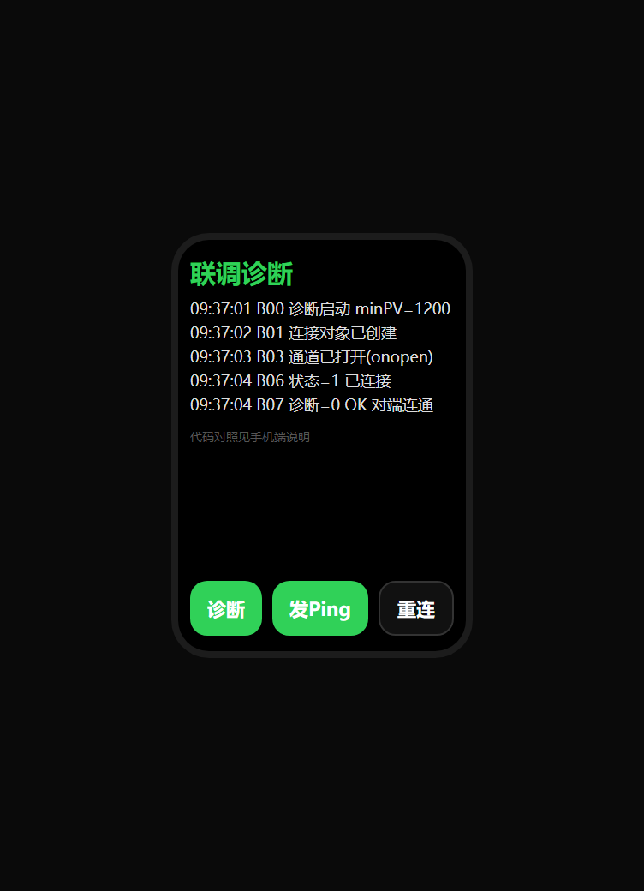</td>
  <td>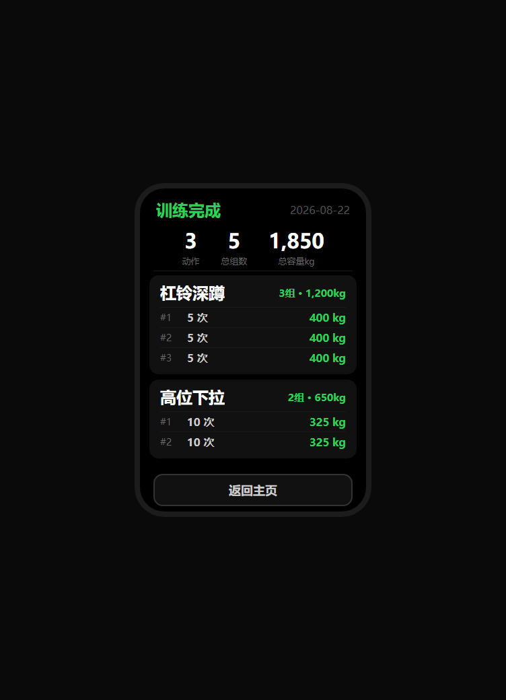</td>
</tr>
<tr>
  <td align="center">屏3 · 历史</td>
  <td align="center">屏4 · 联调诊断</td>
  <td align="center">训练完成 · 汇总</td>
</tr>
</table>

> 界面图按 `.ux` 源码还原（黑底 + 绿色主操作色），数据为示例；画布固定 **336 × 480 px**。
> 屏幕本身**不显示页码指示器**，靠左右滑动切换。

- **屏0 · 计划**：**两级菜单**——左半屏（x < 168px）上下滑动切换部位，右半屏上下滑动切换该部位下的动作（共 28 个动作，**在部位内循环**）；左右加减重量（按各动作步进，**到边界会绕回**另一头）；自重类动作最左端是「自重」档（48px，比数字的 64px 小一号，视觉大小对齐）；当前动作 52px、上一/下一动作各 20px 灰字（`#333333`）作上下文。
  - 重量下方有一行 **PR 参考**（`PR 75kg`，**22px 纯白 / 行高 30px / 字重 600**，显示当前动作手机端记录的历史最高重量，四舍五入到 1 位小数）；
    该动作没有 PR 数据时整行隐藏。数据由手机在手环发送训练记录后**全量回传**，见
    [`INTERCONNECT-GUIDE.md`](INTERCONNECT-GUIDE.md) §6 的 `pr-sync`。
    > 配色说明：**刻意不用绿色** —— `#30d158` 是大号重量数字的颜色，眯眼看容易把这行误读成
    > "当前要举的重量"。白色与动作名同色、黑底对比度 21:1，既清楚又不会与可选重量混淆。
  - **计划最多 10 项**（超出提示「已达上限10项」），新加入的项插在列表**最前面**；
    **长按重量数字 = 退出应用**（返回上一个应用）。
- **屏1 · 记录列表**：顶部是当前时间（每 30 秒刷新一次）；显示已加入计划的项目与已完成组数；
  点击项目开始计次（`-` / 次数 / `+` / 确认 / 取消，**默认 10 次，下限 1、无上限**）；
  长按项目编辑重量（`- / +` / 确定 / 删除，**只对「一组都还没完成」的项目生效**，重量可减到 0 显示成「自重」，且编辑时不校验上限）；
  「结束」保存并**回到屏2「今日数据」**（不是汇总页 —— 汇总页未注册路由，见[已知问题](#已知问题)）。
- **屏2 · 今日数据**：今日各动作的训练明细 + 底部 `总 Nkg`；自重动作显示为 `自重×N`。
- **屏3 · 历史**：按日期列出历史训练（每条含动作与容量），底部「本月 X 天 · 总 Xkg」；
  **长按日期即发送当天数据到手机**（成功/失败/当天无数据都有提示）。
- **屏4 · 联调诊断**：B00/B01… 调试码日志（**只保留最近 30 行**）+「诊断 / 发Ping / 重连」按钮；
  进入应用 2.5 秒后会自动跑一次诊断，手动「重连」后再跑一次。
- **训练完成 · 汇总**（`pages/summary`，**当前不可达**）：展示本次「动作 / 总组数 / 总容量」+ 每个动作的逐组明细，
  底部「返回主页」。页面本身完成度很高，只是没注册进路由 —— 属于死代码。

---

## 系统架构

```
┌────────────────────────────────────────┐
│          小米手环 10 Pro                │
│          (Vela OS 快应用)               │
│                                        │
│  屏0 选动作/重量 → 屏1 计次 → 屏3 发送  │
│  本地落盘 internal://files/             │
│           training_data.json           │
│           (version 2: records + prs)   │
└───────────────┬────────────────────────┘
                │  @system.interconnect
                │  (XMS Wearable SDK)
                │
   ① 手环 → 手机   training-records   训练记录（当天全量）
   ② 手机 → 手环   pr-sync            每个动作的历史最高重量（全量）
   ③ 双向         ping / ping-reply   连通性自检（屏4 按钮触发）
                │
                ▼
┌────────────────────────────────────────┐
│           Android 手机 App              │
│           (Kotlin + Compose)           │
│                                        │
│  收 JSON → 按 (动作名,重量) 合并        │
│  → JSONL 分片落盘（30 行 = 30 天/片）   │
│  → 内存索引 LinkedHashMap<日期, 当天>   │
│  → Compose UI 实时渲染                 │
│  → 落盘成功后回发 pr-sync               │
│                                        │
│  数据 · 肌群 · 日记 · 动作 · 传输        │
└────────────────────────────────────────┘
```

---

## 技术栈

| 组件 | 技术 | 版本 |
|---|---|---|
| **手机端 UI** | Jetpack Compose + Material 3 | Compose BOM 2025.05.01 |
| **开发语言** | Kotlin（手机端）/ JavaScript（快应用） | Kotlin 2.1.21 |
| **构建工具** | Gradle Wrapper + Android Gradle Plugin | Gradle 8.2 / AGP 8.2.2 |
| **目标平台** | compileSdk 36 ｜ targetSdk 30 ｜ **minSdk 21（Android 5.0）** | buildTools 36.1.0 |
| **图表** | Canvas 自绘柱状 / 折线 / 甜甜圈（`Charts.kt` / `PivotCard.kt`），不引第三方图表库 | — |
| **视频播放** | Media3 ExoPlayer（本地 mp4 无缝循环） | 1.4.1 |
| **数据传输** | 手环 `@system.interconnect` ↔ 手机 xms-wearable-lib（XMS Wearable SDK） | SDK 1.4 |
| **数据存储** | SAF 目录为主 + 内部存储兜底；JSONL 分片文件（每片 30 行） | — |
| **权限** | 蓝牙（`BLUETOOTH` / `BLUETOOTH_ADMIN` / `BLUETOOTH_CONNECT` / `BLUETOOTH_SCAN`）+ 定位（老系统扫描需要） | — |
| **动作库** | 1324 个动作随包分发：1324 条 JSON + 1324 个演示视频 + 1324 张图示 | — |
| **手环端** | Vela OS 快应用（aiot-toolkit，`npm run release` 打包） | aiot-toolkit 2.0.5 |
| **应用版本** | 手机 3.1.18 / versionCode 25 ｜ 手环 1.0.70 / versionCode 70 | — |

---

## 项目结构

```
hypergym/
├── phone-app/                      # 手机端 Android 项目（Kotlin + Jetpack Compose）
│   ├── version.properties          # 版本号（versionCode / Major / Minor / Patch）
│   └── app/
│       ├── build.gradle            # 依赖与编译配置（compileSdk 36 / minSdk 21）
│       ├── libs/
│       │   └── xms-wearable-lib_1.4_release.aar    # 小米互联 SDK
│       └── src/main/
│           ├── AndroidManifest.xml     # 蓝牙 + 定位权限、MainActivity
│           ├── java/com/hypergym/
│           │   ├── MainActivity.kt     # 互联回调 → 收数据 → 落盘 → 回发 PR 全量表
│           │   ├── data/
│           │   │   ├── TrainingData.kt    # 数据模型 + JSON 解析 + 同一天合并规则
│           │   │   ├── RecordStore.kt     # 存储引擎（分片 / 去重 / 压缩 / 删除）
│           │   │   ├── DataBackend.kt     # 存储后端抽象（SAF / 内部存储）
│           │   │   ├── StatsEngine.kt     # 统计引擎（纯函数：区间 / 环比 / PR / 热力图）
│           │   │   ├── PrRangePrefs.kt    # PR「实际用范围」百分比的持久化
│           │   │   ├── MuscleMap.kt       # 动作 → 肌群映射（查手环表 → 历史别名 → 关键词）
│           │   │   ├── BandExercises.kt   # 【自动生成】手环动作表镜像，勿手改
│           │   │   └── ExerciseLibrary.kt # 1324 动作库加载 + 中文翻译
│           │   └── ui/
│           │       ├── HyperGymApp.kt     # 根界面（5 Tab + 横向 Pager + 底栏）
│           │       ├── Theme.kt           # 暖橙主题、装饰背景、统一调色板
│           │       ├── DashboardScreen.kt # 数据页（热力图 / 当天 / PR / 英雄卡 / 趋势）
│           │       ├── MuscleScreen.kt    # 肌群页（动作数据汇总 / 肌群占比）
│           │       ├── PivotCard.kt       # 数据透视卡片（自定义 X / Y / 聚合 / 图表）
│           │       ├── DiaryScreen.kt     # 日记页（3 动作卡片 + 长按删除）
│           │       ├── ExerciseScreen.kt  # 动作库（搜索 / 部位筛选 / 视频 / 教学）
│           │       ├── DebugScreen.kt     # 传输页（P/S 码日志 + 联调按钮）
│           │       ├── Charts.kt          # Canvas 自绘柱状 / 折线 / 甜甜圈
│           │       ├── Components.kt      # 通用组件（卡片 / 图例 / SetsLine）
│           │       ├── UiState.kt         # 界面状态（数据快照 / 筛选 / 选中项）
│           │       └── DateUtils.kt       # 日期小工具（周一起算、周期边界）
│           ├── assets/exercises/
│           │   ├── exercises.json     # 1324 个动作（中文名 / 分步教学 / 肌群 / 器材）
│           │   ├── videos/            # 1324 个演示视频（本地 mp4）
│           │   └── images/            # 1324 张动作图示
│           └── res/                   # 自适应图标（5 档密度 × 4 文件）+ 主题与尺寸
│
├── miband10pro-trainer/            # 手环端 Vela 快应用（屏0~屏4 + 汇总页）
│   ├── src/
│   │   ├── app.ux                  # 应用入口
│   │   ├── manifest.json           # 清单：包名 com.hypergym、1.0.70、路由、features
│   │   ├── config-watch.json       # 手表端编译配置
│   │   ├── common/
│   │   │   ├── data.js             # 28 个动作定义（动作名 / 部位 / 重量范围 / 步进 / 自重档）
│   │   │   ├── file-io.js          # training_data.json 读写（version 2：records + prs）
│   │   │   └── interconnect-client.js  # @system.interconnect 封装（连接 / 收发 / B 码日志）
│   │   ├── i18n/                   # 中英文案
│   │   └── pages/
│   │       ├── home/index.ux       # 主界面：横向 5 屏 + 计数浮层（单文件）
│   │       └── summary/index.ux    # 训练完成汇总页（未注册路由，见「已知问题」）
│   └── package.json                # aiot-toolkit 2.0.5；npm run release
│
├── 健身动作库/                      # 原始动作库（1324 个动作 + 视频 + 图片）
├── tools/
│   ├── sync-band-exercises.js      # 手环动作表 → 手机端 BandExercises.kt（构建前自动执行）
│   └── add-ps1-bom.ps1             # 给 .ps1 补 UTF-8 BOM（PowerShell 5.1 必需）
├── build-debug.ps1                  # 一键产出双端安装包（构建前强制校验两端证书指纹一致）
├── ui-prototype/                    # Web UI 原型（暖橙白卡风格）
├── ui-refs/                         # 参考设计图
├── screenshots/                     # 本 README 用到的界面截图（手机端 = 模拟器实拍，手环端 = 按 .ux 还原）
├── logo/                            # App 图标（SVG + Illustrator 源稿）
├── SIGNING.md                       # ⚠️ 签名硬约束，动手前必读
├── INTERCONNECT-GUIDE.md            # 手环 ↔ 手机 互联协议与调试码对照
├── REVIEW.md                        # 代码审查报告（35 项，含证据与状态）
├── TODO.md                          # 待办 / 已搁置项 / 本机环境备忘
├── DESIGN-SYSTEM.md                 # 设计规范
├── .gitignore                       # Git 忽略规则
└── README.md                        # 本文件
```

---

## 快速开始

### 手机端（Android App）

**环境要求：**

- JDK 21
- Android SDK（compileSdk 36, buildTools 36.1.0）
- Gradle 8.2（仓库自带 wrapper，无需另装）
- **`phone-app/keystore.properties`**：签名口令文件，`app/build.gradle` 在配置阶段会**无条件读取**，
  缺了直接构建失败（文件与 `keystore/` 一并入库；签名约束见 [`SIGNING.md`](SIGNING.md)）

**构建步骤：**

```bash
# 进入手机端项目目录
cd phone-app

# 设置环境变量（Linux/Mac）
export JAVA_HOME=/path/to/jdk21
export ANDROID_HOME=/path/to/android-sdk

# 构建 Debug APK（日常自用推荐，版本号用 version.properties 的当前值）
./gradlew assembleDebug

# 构建 Release APK
./gradlew assembleRelease

# APK 输出路径
# phone-app/app/build/outputs/apk/debug/app-debug.apk
# phone-app/app/build/outputs/apk/release/app-release.apk
```

> Windows 用 `gradlew.bat` 替换 `./gradlew`。
>
> ⚠️ **`assembleRelease` 会先自增版本号再构建**：读 `version.properties` → `versionCode +1`、`patch +1`
> → **写回文件** → 用新版本号构建。所以跑一次 release，产出的是**下一个版本**（例如仓库当前是
> 3.1.18/25，跑完会得到 **3.1.19/26** 且 `version.properties` 已被改写）。
> 日常出 debug 包不会自增；`build-debug.ps1 -Bump` 是另一套（走 `assembleDebug`，只 +1 一次）。

### 手环端（Vela 快应用）

**环境要求：**

- Node.js >= 8.10
- aiot-toolkit >= 2.0.5

**构建步骤：**

```bash
cd miband10pro-trainer
npm install
npm run release  # 发布 rpk 包（必须用 release，见下方警告）
```

> ⚠️ **装到手环上的 rpk 不要用 `npm run build` 打包。**
> `aiot` 在 development 模式下，若找不到 `sign/debug/` 与 `sign/private.pem`，会**静默回退到
> aiot-toolkit 自带的调试证书**去签名。这样打出的 rpk 与手机 APK 签名不一致，
> 手环与手机会**彻底无法通信**（`system.interconnect` 直接拒绝握手），而且这个问题
> **源码 diff 查不出来**（证书不在源码里）。只有 `release`（production 模式）才会用
> `sign/release/` 里那张与手机一致的证书。详见 [`SIGNING.md`](SIGNING.md)。

### 一键构建双端（本机）

仓库根目录的 `build-debug.ps1` 封装了本机构建链（`.research/` 内的 JDK 21 / Gradle / Android SDK）：

```powershell
.\build-debug.ps1 -Only band -Bump    # 只构建手环端并递增版本
.\build-debug.ps1 -Only phone -Bump   # 只构建手机端并递增版本
.\build-debug.ps1                     # 双端都构建
```

脚本在构建前会**强制校验手环证书与手机 APK 证书的指纹一致**，不一致直接中止；
构建后还会扫描 aiot 日志，确认没有落到 toolkit 内置证书。产物统一输出到 `demo-package/`。

---

## 数据流详解

### 传输协议（三条消息）

| # | 方向 | `type` | 内容 | 触发时机 |
|:--:|---|---|---|---|
| ① | 手环 → 手机 | `training-records` | 当天的**全量**训练记录（`date` + `records`） | 屏3 长按某个日期 |
| ② | 手机 → 手环 | `pr-sync` | 每个动作的历史最高重量（全量表，约 28 项） | 手机把 ① 落盘成功后**立刻回发** |
| ③ | 双向 | `ping` / `ping-reply` | 连通性自检 | 屏4「发Ping」按钮；手环也会自动跑诊断 |

> ③ 的细节与判定速查见 [`INTERCONNECT-GUIDE.md`](INTERCONNECT-GUIDE.md) §5 / §6。

**① 手环 → 手机**：

```json
{
  "type": "training-records",
  "date": "2026-08-15",
  "records": [
    {
      "exercise": "杠铃深蹲",
      "weight": 80,
      "sets": [
        { "set": 1, "reps": 8, "volume": 640 },
        { "set": 2, "reps": 8, "volume": 640 },
        { "set": 3, "reps": 6, "volume": 480 }
      ]
    }
  ]
}
```

**② 手机 → 手环**（`pr-sync`，每次全量、无增量与版本令牌）：

```json
{ "type": "pr-sync", "prs": { "卧推": 80, "杠铃深蹲": 75, "高位下拉": 38 } }
```

手机端**不维护"已下发过什么"的镜像**（PR 每次由 `StatsEngine.bestWeights(全部历史)` 现算），
所以手环重装、数据丢失、两端不一致都会在下一次下发时整体覆盖修正。

### 两端的本地存储

**手环端**：`internal://files/training_data.json`，**全量覆盖写**，`version: 2`：

```json
{
  "app": "strength-trainer",
  "version": 2,
  "records": { "2026-10-01": [ { "exercise": "卧推", "weight": 70, "sets": [ … ] } ] },
  "prs": { "卧推": 80 }
}
```

- 手环保存时**也会按 (动作名, 重量) 合并**到当天已有记录并重排组号（与手机同一套规则）
- 老文件没有 `prs` 字段 → 读出来是空表 → 下次同步自动补齐，不需要额外的判断代码
- **保护位**：读文件解析失败时置 `readBroken` 并**拒绝一切保存**（宁可本次保存失败，也不覆盖原文件）；
  只有「文件不存在」（首次使用）不置位 —— 这是 v3.1.10 修掉的一次真实丢数据路径

**手机端**：JSONL 分片 + 内存索引。

- **合并**：以 `date` 定位当天，再按 **(动作名, 重量)** 合并——payload 里出现的键**替换**成 payload 的组列表，
  payload 里没有的键**原样保留**；同键的「组」按 (次数, 容量) 做**多重集合并**。
  于是「同一天分多次传输」会**累加**（先传 7 个动作、再传 3 个 → 共 10 个），
  「重复发送同一份」是**幂等**的（不会翻倍），手环中途丢数据时手机上已有的组**也不会被吃掉**。
  *（旧版是"同日期后到覆盖先到"，会把先传的数据整体抹掉——这正是曾经丢数据的根因。）*
- **分片**：`records-NNNN.jsonl`，每片 **30 行**；一行 = 一整天（日期做主键），所以**一片约 30 天**。
- **写盘**：append-only，写入后**逐行 `fsync`**；只有压缩 / 删除 / 切换目录才全量重写。
- **压缩**：总行数 **> 1200** 时自动重写（去重后重新分片）。
- **多线程**：所有读写都排在**单线程队列**里串行执行，`days` 索引同步读、单线程写。
- **持久化**：SAF 目录（用户授权的公共文件夹）为主，**卸载重装数据不丢**；没选目录时落到内部存储
  `filesDir/hypergym/`（卸载即丢）。
  > ⚠️ SAF 的授权记录存在 SharedPreferences 里，**卸载会一起清掉** —— 重装后要**重新选一次数据目录**
  > 才会回到 SAF 模式（文件还在原目录里，不会丢）。
- **读取范围**：启动 / 回前台 / 切目录都会重扫目录下**所有** `.jsonl`（含旧版 `records.jsonl`，
  以及目录里其它来源的 `.jsonl`，只读合并）；删除与压缩只动 `records*.jsonl`。
- **迁移**：① `filesDir` 根目录的旧 `*.jsonl` → `filesDir/hypergym/`；
  ② SAF 目录里的旧单文件 `records.jsonl` → 新分片。两段都是「先合并、成功后删旧」。
- **删除联动**：日记页删除某天记录 → 内存索引移除 → 全量重写数据文件（失败则回滚内存），
  数据 / 肌群 / 日记三页立即刷新。

---

## 手环内置动作（28 个）

来源：`miband10pro-trainer/src/common/data.js`（表里的顺序 = 手环上的实际呈现顺序：
先按 `GROUP_ORDER` 排部位，部位内按 `DEFAULT_EXERCISES` 的声明顺序）。
「自重档」表示该动作最左端多一个**「自重」档**（下标 0），其后才是正常配重。

| 部位 | 动作 | 重量范围 (kg) | 步进 (kg) | 自重档 |
|---|---|---|---|---|
| 胸 | 卧推 | 40 – 90 | 5 | |
| 胸 | 水平胸推 | 20 – 90 | 5 | |
| 胸 | 坐姿飞鸟 | 10 – 80 | 2 | |
| 胸 | 下斜胸推 | 20 – 90 | 5 | |
| 胸 | 双杠臂屈伸 | 10 – 60 | 5 | ✓ |
| 肩 | 哑铃 | 10 – 60 | 2 | |
| 肩 | 侧平举 | 10 – 60 | 2 | |
| 肩 | 坐姿肩推 | 20 – 80 | 5 | |
| 肩 | 面拉 | 20 – 60 | 2 | |
| 肩 | 实力推 | 20 – 50 | 5 | |
| 背 | 高位下拉 | 20 – 80 | 2 | |
| 背 | 大剪刀 | 20 – 90 | 5 | |
| 背 | 高位划船 | 20 – 90 | 5 | |
| 背 | 坐姿划船 | 20 – 80 | 2 | |
| 背 | 俯身划船 | 20 – 80 | 5 | |
| 背 | 轨道划船 | 20 – 80 | 5 | |
| 背 | 引体向上 | 10 – 30 | 5 | ✓ |
| 腿 | 哈克深蹲 | 20 – 90 | 5 | |
| 腿 | 杠铃深蹲 | 40 – 80 | 5 | |
| 腿 | 倒蹬 | 30 – 90 | 5 | |
| 腿 | 髋外展 | 20 – 80 | 2 | |
| 腿 | 髋内收 | 20 – 80 | 2 | |
| 腿 | 髋伸展 | 20 – 80 | 2 | |
| 腿 | 腿弯曲 | 40 – 80 | 5 | |
| 腿 | 火箭推 | 20 – 60 | 5 | |
| 臂 | 牧师椅 | 10 – 60 | 2 | |
| 核心 | 卷腹 | 10 – 30 | 5 | ✓ |
| 核心 | 罗马椅 | 10 – 30 | 5 | ✓ |

**28 个动作 = 胸 5 · 肩 5 · 背 7 · 腿 8 · 臂 1 · 核心 2**（与 `GROUP_ORDER` 的部位顺序一致）；
其中 **4 个**动作带自重档：双杠臂屈伸、引体向上、卷腹、罗马椅。

> 手机端**动作库浏览页**（1324 个动作）与手环动作列表**完全解耦** —— 那是独立的参考教学页面。
> 但**动作 → 肌群的分类**必须与上表逐条一致，见下节。

### 动作分类如何与手环保持一致（自动同步）

手机端记录的每个动作名都来自手环 payload（手机没有手工录入入口），所以「动作属于哪个部位」
必须以手环动作表为准。`data.js` 里每个动作都显式带了 `group`，它就是**唯一权威来源**。

实现方式：**构建期自动生成**，不需要手工同步。

```
miband10pro-trainer/src/common/data.js      ← 手环动作表（唯一权威来源）
        │  tools/sync-band-exercises.js      （build-debug.ps1 每次构建手机端前自动执行）
        ▼
phone-app/.../data/BandExercises.kt          ← 自动生成的 Kotlin 常量（勿手改）
        │
        ▼
phone-app/.../data/MuscleMap.kt              ← 分类：查表 → 历史别名 → 关键词
```

**以后只要在 `data.js` 里增减动作或改 `group`，手机 APK 会跟着变**，无需手动改 Kotlin。
生成器会校验并直接中止构建：动作重名、`group` 不在 `GROUP_ORDER` 里、`data.js` 结构变化等
异常都不会被静默打进包里；动作被移除时还会提醒去 `MuscleMap` 的 `LEGACY_ALIASES`（或关键词）
补上历史映射 —— 旧记录里可能还有那个名字，不补就会掉进「其他」。

手动执行：

```bash
node tools/sync-band-exercises.js            # 生成/更新（打印新增/删除/改分类的差异）
node tools/sync-band-exercises.js --check    # 只校验是否同步，漂移则 exit 1
```

> 为什么生成 Kotlin 而不是 assets JSON：生成 Kotlin 是编译期常量，分类不再需要 `Context`，
> 也不存在「没初始化就静默降级」的顺序依赖。旧实现曾用 1324 条英文动作库做模糊匹配，
> 且 `init()` 只在肌群页被调用过 —— 没进过肌群页就会退化成纯关键词匹配，同一个动作的分类
> 取决于用户点过哪些页面；模糊匹配本身也会误判（26 个动作里有 6 个分错，例如「水平胸推」
> 被匹配成「后水平」而算作**背**）。现在改为精确查表，两个问题一并消失。

---

## 设计语言

**暖橙 + 白卡 + 柔和阴影**（区块化）：卡片统一 **18dp 圆角**、页面浅灰底、纯白卡片、极轻阴影。

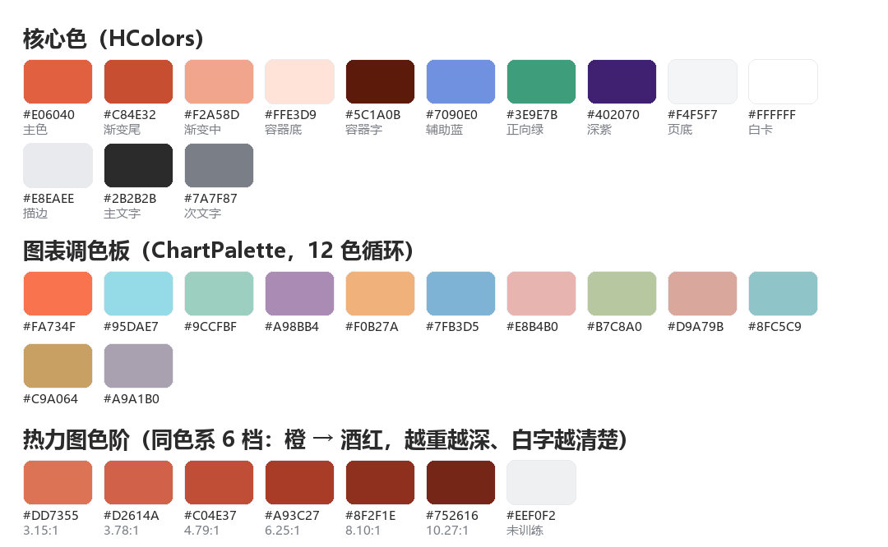

**核心色（`ui/Theme.kt` 的 `HColors`）**

| 名称 | 色值 | 用途 |
|---|---|---|
| Primary | `#E06040` | 按钮、图表高亮、容量数字 |
| PrimaryDeep | `#C84E32` | 渐变尾部 |
| PrimaryLight | `#F2A58D` | 渐变中间 |
| PrimaryContainer | `#FFE3D9` | 主色容器底色 |
| OnPrimaryContainer | `#5C1A0B` | 容器上的文字 |
| Blue | `#7090E0` | 辅助图表 |
| Green | `#3E9E7B` | 正向 / 达标 |
| Purple | `#402070` | 深紫（点缀） |
| Background | `#F4F5F7` | 页面底色 |
| Card | `#FFFFFF` | 白色卡片（纯白） |
| Border | `#E8EAEE` | 卡片描边 / 分隔线 |
| TextPrimary | `#2B2B2B` | 主文字（深灰黑） |
| TextSecondary | `#7A7F87` | 次级文字（中灰） |

**图表调色板**：`ChartPalette` 共 12 色（珊瑚 / 天蓝 / 柔绿 / 淡紫 / 暖黄…），
**「动作数据汇总」与「数据透视」两张卡共用这一套** —— 所以同一天的同一个动作在两张卡里是同一种颜色。

> 另外两套色不要混：**肌群占比**与 **PR 卡的肌群色点**用的是手环那套**部位色** `GROUP_COLORS`
> （`MuscleMap.colorOf`），**热力图**另有 4 档专色 `HeatPalette`。

**热力图色阶**：按容量**名次**平均分 4 档**实色**（不是给主色加透明度 —— alpha 叠在白卡上会发灰发脏）。
日期数字**已训练一律白字、颜色保持不变**，所以 4 档都必须落在"白字看得清"的深度范围内：

| 档位 | 色值 | 白字对比度 |
|:--:|---|---|
| 1 最轻 | `#DD7355` | 3.15 : 1 |
| 2 | `#E06040` | 3.55 : 1 |
| 3 | `#C84E32` | 4.57 : 1 |
| 4 最重 | `#A63C24` | 6.38 : 1 |
| 未训练 | `#EEF0F2`（冷灰） | 深色数字 |

> 反面参照：浅橙 `#E8836A` 上放白字只有 **2.66 : 1**，实际根本读不出来 —— 这就是色阶取
> 「鲑橙 → 主橙 → 深橙 → 砖红」、靠明度 + 饱和度共同拉开差别的原因。

---

## 应用图标

图标由 `logo/` 下的 SVG 生成，**分两层**（Android 自适应图标结构）：

| 层 | 内容 | 来源 |
|---|---|---|
| `ic_launcher_background` | 橙色渐变 + soft-light 纹理 | `logo/back.svg` 的渐变 + `front.svg` 里的纹理 |
| `ic_launcher_foreground` | 11 个纯白矢量图元（哑铃），透明底 | `logo/front.svg` |

**为什么纹理必须留在背景层**：`front.svg` 里的纹理用的是 `mix-blend-mode: soft-light`，它的混合底就是那层渐变。
若把纹理挪到透明的前景层，会因为「无底色可混合」而露出脏斑。两层叠加后与原始 SVG 完全一致。

**尺寸与安全区**：自适应图标只显示中心 **72/108**，绝对安全区是 **66dp 的圆（占画布 61.1%）**。
实测本图标哑铃占画布宽 **49.1%**，完整落在安全圆内，因此任何遮罩形状都不会裁到图形。

> 未采用 `front2.svg`：它的哑铃占宽 **72.7%**，超出 66.7% 的可见区，圆形遮罩会切掉最外侧的配重片。
> 两者是同一幅作品的等比例放大（长宽比 2.04 : 2.03），所以缩到安全尺寸后结果与现用的一致。

**资源清单**（5 个密度 × 4 个文件，均为 PNG）：

```
mipmap-{mdpi,hdpi,xhdpi,xxhdpi,xxxhdpi}/
  ic_launcher.png             48dp  传统图标（满幅作品，未裁切）
  ic_launcher_round.png       48dp  同上
  ic_launcher_background.png 108dp  自适应背景层（满幅不透明）
  ic_launcher_foreground.png 108dp  自适应前景层（透明底 + 哑铃）
mipmap-anydpi-v26/
  ic_launcher.xml, ic_launcher_round.xml   自适应图标定义
```

> 密度变体由 432×432 / 1024×1024 的母版**面积平均重采样**得到（不是逐尺寸渲染）。
> 面积平均是缩小的正确算法；且重采样时颜色按 alpha 预乘后再平均，避免透明边缘出现黑边。

**生成时必须注意的一点**：渲染页要用**固定像素定位**（`position:fixed; left:0; top:0; width:Npx`），
**不要用 `100vw/100vh`**。Chrome 在 Windows 上会把窗口宽度钳制到约 499px：请求宽度小于该值时，
容器变成非正方形，方形 SVG 会按 `xMidYMid` 在更宽容器里水平居中，截图再从左裁切 —— 内容整体右移
`(499 − 请求宽度)/2`。v3.1.14 就是这样把哑铃画歪了 33.5px。
**每个产物都必须校验居中**（图形边界框中心 = 画布中心，容差 ±0.5px）。


---

## 更新记录

### 手机端 v3.1.18（versionCode 25） ｜ 手环端 v1.0.70（versionCode 70）

**修复：热力图收起时显示的是「最近 7 天」，而不是「今天所在的这一周」**

以 10 月 1 日（周四）为例：收起态显示 `25 26 27 28 29 30 01`（五 六 日 一 二 三 四），
看着像"9 月最后一星期"；点开「展开整月」却是 `28 29 30 01 …`（一 二 三 四 五 六 日）。
同一张卡片，收起和展开是两套口径。

- 原因：收起态用的是**滚动最近 7 天**（`(6 downTo 0)` 配 `DateUtils.offset(today, -i)`），
  和月历的**自然周（周一→周日）**根本不是一回事
- 改成取**今天所在的那一周**：`weekdayIndex(today)` 回退到周一，再往后数 7 天，
  与展开后的列排布完全一致
- 今天**之后**的格子（周五 / 六 / 日）沿用月历口径：**灰块占位、不写日期、不可点**
- 只动数据来源，格子样式、色阶、点选行为都没变

**修复：「PR 纪录」里橙色 PR 与黑色范围贴得太紧**

展开某个肌群后，`80kg` 与 `52.5–55.0kg` 之间几乎没有间隙（真机实测最紧处约 **3.5–5dp**，
范围文字越长越明显）。这两个数字量纲不同（历史最高 vs 今天该上的配重），挤在一起不好读。

- 在两者之间加 **10dp 固定间隙**（`Spacer`）：橙色 PR 相应左移，范围数字的右对齐位置不变
- 间隙是**固定值**，不随字体宽度变化 —— 真机（字体更宽）约 3.5–5dp → **13.5–15dp**；
  模拟器（字体较窄）约 13dp → 23dp
- 动作名那一列是 `weight(1f)`，自动让出这 10dp；动作名最长 4~5 个字，仍然宽松

**顺带**：README / REVIEW 的版本基线跟到 3.1.18（versionCode 25）。手环端本次**未改动**，
仍是 v1.0.70（versionCode 70），两端协议与签名都没动。

**文档全量校对（同批）**：按当前 APK / RPK 逐条核对了 README 的每个事实 ——
手环动作表的**顺序与数量**（补上各部位分解与自重档清单）、手环侧存储格式与保护位、
手机端存储规则（每片 **30 行 = 30 天**，不是 30 条记录）、**P/S 调试码的完整范围**（补 P02b / S02r）、
数据页实际卡片清单（补上「容量趋势」「月份选择器」）与三档区间的真实口径、
肌群页的配色来源、传输页「清除」的真实语义、构建前置条件与 `assembleRelease` 的自增行为。
`screenshots/` 里 **8 张手机端截图**全部用 3.1.18 的包在模拟器上重拍（新增 PR 卡片图），
**6 张手环端示意图**按 `.ux` 源码逐项对齐重绘，另新增配色总览图 `palette.png`。

### 手机端 v3.1.17（versionCode 24） ｜ 手环端 v1.0.70（versionCode 70）

**新增：把手机端的 PR 回传到手环，屏0 选重量时可直接参考**

- 屏0「选动作 / 选重量」页，在**重量下方、增加按钮上方**新增一行 `PR 75kg`，
  显示当前动作在手机里记录的**历史最高实际重量**；没有 PR 数据的动作整行隐藏（模板 `if` 控制）
- **可读性调过一轮**（真机看过之后）：第一版是 18px + `#666666`，在黑底上对比度只有 **3.66:1**，
  用户近视看不清。改成 **22px 纯白 `#ffffff`（对比度 21:1）+ 字重 600**。
  行高随之显式设为 30px，高度账 `190+120+30+130 = 470 ≤ 480`，仍然不挤压现布局
  - **刻意不用绿色**：`#30d158` 是大号重量数字的颜色，眯眼看容易把这行误读成
    「当前要举的重量」（以为在举 75，其实是 45）。白色与动作名同色，既清楚又不会混淆
- **触发时机**：手环每发一次训练数据、且手机落盘成功后，手机**立刻回一包** PR 全量表 ——
  一次发送就是一次双向交换，**没有其它触发器**
- **每次全量**：手机不维护"已下发过什么"的镜像（PR 由 `StatsEngine.bestWeights(全部历史)` 现算），
  所以不需要 diff、不需要版本令牌；手环重装、数据丢失、两边不一致都会在下一次下发时被整体覆盖修正。
  整表约 28 项、几百字节，比一条训练记录还小
- 新增消息 `pr-sync`（手机→手环），协议见 [`INTERCONNECT-GUIDE.md`](INTERCONNECT-GUIDE.md) §6；
  新增调试码 **B11**（手环收到并更新 PR 表）/ **P18**（手机下发成功，带项数）/ **P19**（下发失败）
- 手环侧 `training_data.json` 格式 `version` 1 → 2（新增 `prs` 字段，与 `records` **同一个文件**、
  仍然是全量覆盖写）。老文件没有 `prs` → 读出来是空表 → 下次同步自动全量补齐，**不需要额外的判断代码**
- 为承载新字段，`file-io.js` 的 `readRecords/saveRecords` 改为 `readData/saveData`（回调改为
  `{records, prs}`）；并加了内存兜底，避免只关心记录的保存点误把 PR 表抹掉
- **向后兼容**：老 rpk 不认识 `pr-sync`，只会记一条 B09 日志，无害；手环发出的消息字段无任何新增，
  所以新老两端任意组合都能配对

**顺带修正**：屏0 的动作数量描述由 26 改为 28（上一版 `data.js` 新增了实力推 / 火箭推）

### 手机端 v3.1.16（versionCode 23） ｜ 手环端 v1.0.68（versionCode 68）

**修复（手环端）：计数浮层上的「kg」被裁成「ka」**

屏1 点动作进入计数状态后，顶部那行 `{{countEx}} {{countWtText}}`（如「高位下拉 22kg」）里的
**`g` 只显示出上半截**，看起来像 `ka`。

- 不是文字太长被横向截断：该行在 26px 字号下只有约 163px 宽，而容器是 336px，左右各留约 86px
- 真正原因是**高度不够**：`.rec-count-wrap` 写死 `height: 480px`，而内部各段加起来约 541–557px；
  flex 纵向布局默认 `flex-shrink: 1`，会把子项**压扁**去凑高度。文字一旦被压到低于行高，
  先掉的就是字形盒最下沿的**降部**——`g` 的尾巴。
- 旁证：`.rec-count-btn` 早就手动写了 `flex-shrink: 0`（作者已挡过按钮被压缩），
  于是压缩量全落到文字上；而这一屏唯一带降部的字符就是 `g`，大字 `10`、`确认`、`取消` 都没有降部，
  它们看起来也确实正常。
- 改法：给该行显式 `line-height: 36px`（降部有地方放）、加 `flex-shrink: 0`（不再被压扁）、
  `margin-top` 90→52（整行上移 38px），并把相邻几处 margin 60→36/32、20→16，
  使总高压到 **464px**（480px 内留余量），从根上不触发 flex 压缩。

**手环动作表调整（`data.js`）**

- 新增 **实力推**（肩，20–50kg）与 **火箭推**（腿，20–60kg），共 **28** 个动作
- 上调重量上限：坐姿肩推 / 坐姿飞鸟 / 高位下拉 / 坐姿划船 / 俯身划船 / 轨道划船 / 髋外展 /
  髋内收 / 髋伸展 → 80kg；倒蹬 → 90kg；腿弯曲改为 40–80kg
- 卷腹上限 50 → 30kg；**面拉去掉自重档**（不再有 `bw` 标记）
- 手机端的动作分类表由同步脚本自动跟随，无需手工改（见[应用图标](#应用图标)上方的同步说明）

**修复：组数多的时候，容量汇总被挤压变窄**

组数多（>6 组）的动作，次数 chips 会占满整行，把同一行右侧的汇总数字压成**逐字竖排**
（「共80个」变成一列、「容量 4,560 kg」被切成两行）。数据页「今日数据」与日记页「训练日记」
共用同一段渲染代码（`Components.kt` 的 `SetsLine`），所以两页同时受影响。

改法：**只有 chips 折行，汇总数字始终右对齐**。

- 每行最多放 **6 个** chips，第 7 个起折到下一行
- 汇总数字**一律右对齐**（与组数多少无关），所以无论 4 组还是 8 组，汇总都落在同一条竖线上，便于扫读
- 同一动作有多个重量时（如卷腹 自重×8组 + 15.0kg×8组）每个重量各自判定，因此会出现
  **4 行**（每个重量 2 行），但仍挂在该动作下面

**改版：PR 纪录卡片**

- **每个肌群可折叠**（默认全部收起，点肌群行展开，可同时展开多个）。收起时整张卡片约 240px，
  不再是最初那种一长条
- 展开后**每个动作一行**，只保留两个数字：**PR**（主题橙）与**实际用**（主文字色/黑）；
  原来的 `×65%` / `×70%` 两列与每个肌群里的列头行都已去掉
- **实际用** = `PR × 下限%` 与 `PR × 上限%`，各自按 **2.5kg 四舍五入**（杠铃片最小组合单位），
  两端相同就只显示一个值；结果固定 1 位小数，只会出现 `.0` / `.5`
- 卡片右上角新增两个**百分比输入框**（默认 `65` `70`），可手输；改完下面所有数字立即重算。
  该设置**持久保存**（`data/PrRangePrefs.kt`，SharedPreferences），重开 App 仍是上次输入的值
- PR 取法、分组顺序、组内降序、只显示有配重的动作 —— 均未改动

### 手机端 v3.1.15（versionCode 22） ｜ 手环端 v1.0.67（versionCode 67）

**修复：图标里的哑铃没有水平居中（左右偏右 33.5px）**

v3.1.14 的图标在垂直方向是居中的，但水平方向整体右移了 **33.5px**（占画布 7.87%）。
根因出在**生成图标的渲染方式**，不在 SVG 本身（`front.svg` 的图形几何中心正好是 216,216，
即画布正中）：

- 生成时用 `100vw/100vh` 布局，而 **Chrome 在 Windows 上把窗口宽度钳制到约 499px**
- 请求宽度小于 499 时，容器变成「499 × 请求高度」这种非正方形
- 方形 SVG 按 `preserveAspectRatio` 的 `xMidYMid` 在更宽的容器里**水平居中**
- 截图再按请求宽度**从左侧裁切** → 内容整体右移 `(499 − 请求宽度)/2`；432 档预测 33.5px，实测 33.53px

顺带解释了一个当时没查清的旧现象：v3.1.14 之前那批"小尺寸渲染失败（整幅全透明/单色）"，
是同一根因 —— 108px 档位下 SVG 被推到 x≈195 处，而截图只取左侧 0..108，于是完全落空。
另外背景层左侧因此留下一条 34px 纯白带（截图底色），右侧 34px 渐变被截掉；
纯白带正好落在自适应图标遮罩之外，所以肉眼看不到，但哑铃的偏移在遮罩内可见。

**修法**：改为**固定像素定位**（`position:fixed; left:0; top:0; width:Npx`），元素位置与视口无关；
窗口开到 560（高于钳制阈值）后按已知坐标裁切。

**新增校验**：每个产物都检查居中（边界框中心须落在画布中心 ±0.5px）。校验结果：

| 检查项 | 结果 |
|---|---|
| 前景层剪影居中（108/162/216/324/432） | 偏移 **(0.00, 0.00)** px |
| 传统图标居中（48/72/96/144/192） | 偏移 **(0.00, 0.00)** px |
| 背景层左侧纯白带 | **0 px**（已消除） |
| 拆层忠实性：两层合成 vs `front.svg` 原生渲染 | 最大差 **1/255**、平均 0.005（8 位量化舍入） |

> **流程教训**：v3.1.14 之所以漏掉，是因为当时只校验了尺寸、颜色数、安全区宽高，**从没校验"居中"**；
> 而且当时给的预览图是用 SVG 现画的，不是用产出的 PNG —— 于是预览看着正、出货的位图是歪的。
> 现在预览图改为由**出货的那两张 PNG** 合成。

### 手机端 v3.1.14（versionCode 21） ｜ 手环端 v1.0.67（versionCode 67）

> ⚠️ 此版图标存在水平偏移 33.5px，请用 v3.1.15 及以上。

**新增：应用图标**

- 换成由 `logo/front.svg` 生成的自适应图标（渐变背景 + 白色哑铃），替换掉原来的占位图标
  （白底 + `logo_fg.png`）。生成方式与尺寸校验见 [应用图标](#应用图标)一节。
- 清理三个随之失效的占位资源：`drawable/ic_launcher_background.xml`（白底 shape）、
  `drawable-v24/ic_launcher_foreground.xml`、`drawable-nodpi/logo_fg.png`（约 119 KB）

**修复：数据页「容量趋势」卡片在「月」档的日期顺序反了**

- 旧日期在左、新日期在右 —— 「周 / 全部」两档本来就是对的，只有「月」档是倒序
  （`monthTrendPoints` 用了 `(endDay downTo 1)`），已改为升序
- **打开或刷新后自动聚焦到最新日期**（滚到最右端），与「动作数据汇总」「数据透视」保持一致

**性能优化（数据透视）**

数据透视的重算复杂度原本是 **O(桶 × 序列 × 记录)** —— `valueOf()` 每次调用都对全量记录做一次
`filter`，而它被调用「桶数 × 序列数」次。更糟的是 `bucketKey` 写在过滤条件里反复求值，
当 **X 轴选「周」** 时，每次求值都要走一次
`Calendar.getInstance()` + `SimpleDateFormat.parse` + `format`。

耗时对比（V8 实测，真机 ART 会更慢；已用 1120 个参数组合验证输出完全不变）：

| 数据透视设置 | 200 天 / 584 条记录 | |
|---|---:|---:|
| | 优化前 | 优化后 |
| 周 × 动作 × 多项 | 450.0 ms | **0.37 ms（快 1230×）** |
| 日期 × 动作 × 多项 | 7.4 ms | **0.29 ms（快 26×）** |
| 日期 × 肌群 × 多项 | 3.7 ms | **0.14 ms（快 27×）** |
| 日期 × 动作 × 单项 | 0.8 ms | **0.07 ms（快 11×）** |

改法：

- **每条记录只算一次**分桶键/序列键，不再在过滤条件里反复求值
- 一次遍历直接建 `桶 → 序列 → 日期 → 记录` 索引，`valueOf` 退化为 O(1) 查表，整体降到 **O(记录数)**
- 「所在周的周一」改用纯整数算法（Howard Hinnant 的 `days_from_civil` / `civil_from_days`），
  **不再经过 `SimpleDateFormat` / `Calendar`**；已对 1970-01-01 ~ 2035-12-31 共 24106 天与旧实现逐日比对，结果一致
- 顺带移除了 `PivotCard` 对 `StatsEngine` 日期格式化的依赖（那个 `SimpleDateFormat` 是全进程共享实例，
  非线程安全，见 [`REVIEW.md`](REVIEW.md) M5）

输出口径完全未变：分桶/序列顺序取首次出现序，排序保持稳定，「先按天求指标、再对天求和/平均」照旧。

> 剩余的性能问题（切页跨页动画、非惰性柱状图、Canvas 逐帧测量文字、数据快照导致全量重算）
> 已记入 [`TODO.md`](TODO.md) §②，按批次待办。

### 手机端 v3.1.12（versionCode 19） ｜ 手环端 v1.0.67（versionCode 67）

**修复**

- **动作分类与手环不一致**：26 个手环动作里有 **6 个分错部位**，直接导致数据页 PR 卡片、
  肌群占比、数据透视的**分组错乱**。逐条如下：

| 动作 | 手环认定 | 修复前（错） | 出错原因 |
|---|---|---|---|
| 哑铃 | 肩 | 其他 | 被当作「纯器材名」跳过，又无关键词命中 |
| 水平胸推 | 胸 | **背** | 模糊匹配到相似度仅 0.60 的「后水平」 |
| 大剪刀 | 背 | 腿 | 旧别名表把「大剪刀」硬编码成腿，与手环表冲突 |
| 罗马椅 | 核心 | 其他 | 无关键词命中 |
| 腿弯曲 | 腿 | 其他 | 关键词只写了「腿弯举」，漏了「腿弯曲」 |
| 面拉 | 肩 | **背** | 关键词表把「面拉」放在背下 |

- **分类存在「页面顺序依赖」**：`MuscleMap.init()` 只在**肌群页**被调用过，若没进过肌群页，
  分类会静默退化成纯关键词匹配 —— 同一个动作的分类结果取决于用户点过哪些页面。
  且 `groupCache` 是普通 `HashMap`，存在并发写风险。
- **历史动作名不能掉队**：从 git 历史里挖出 `data.js` **曾经出现过的全部 29 个动作名**
  （当前 26 个 + 已移除的 `坐姿胸推`、`胸推`、`肩推`），逐个核对新逻辑 —— 旧记录里仍会有
  这些名字，一个都不许归进「其他」。`胸推` 这类名字的关键词也相应补上了。

**变更**

- 动作分类改为**精确查手环动作表**：`data.js` 的 `DEFAULT_EXERCISES` 是唯一权威来源，
  构建期由 `tools/sync-band-exercises.js` 自动生成为 `BandExercises.kt`。
  **以后改 `data.js` 的动作或 `group`，手机 APK 会跟着变**（`build-debug.ps1` 每次构建前自动同步）。
- 判定顺序改为纯函数，**不依赖任何初始化**：手环动作表 → `LEGACY_ALIASES`（历史动作名）
  → 关键词 → 其他。删除了原来的 1324 条动作库模糊匹配。
- 分组配色与展示顺序也一并取手环 `GROUP_COLORS` / `GROUP_ORDER`，两端彻底一致
  （手环没有的「有氧 / 颈」保留原配色，供历史数据归类）。
- 副作用：肌群页不再为分类解析 941 KB 的 `exercises.json`，少了那次白屏。

**新增**

- `tools/sync-band-exercises.js`：动作表同步工具（支持 `--check` 漂移校验），异常直接中止
  构建，动作被移除时会提醒补 `LEGACY_ALIASES`
- `tools/add-ps1-bom.ps1`：给 `.ps1` 补 UTF-8 BOM（PowerShell 5.1 缺 BOM 会把中文按 ANSI
  解析并报假的语法错误）

### 手机端 v3.1.11（versionCode 18） ｜ 手环端 v1.0.67（versionCode 67）

> ⚠️ 本版 PR 卡片的**布局**已在 v3.1.16 改版（改成「肌群可折叠 + 每行一个动作 + 百分比换算」），
> 下面第 1 条描述的横向排布**已不再适用**，保留原文仅供追溯。

**新增**

- **数据页新增「PR 纪录」卡片**（在「当天训练卡片」下方）：列出每个动作的历史最高重量
  - 按肌群分组、一组一行，**不写肌群名**，只用该肌群的颜色点表示；组内按重量降序
  - 只显示有配重（`weight > 0`）的动作 —— 自重按口径不算 PR
  - 始终基于全部历史，不随「周 / 月 / 全部」变化
  - 一组动作超过一行时自动换行，续行缩进对齐（用 `Row { 色点 + FlowRow(weight=1f) }` 实现）
- 新增 `StatsEngine.bestWeights(days)`：每个动作的历史最高重量。
  注意它与 `prFlags` 的区别——`prFlags` 是「**哪天**打破了纪录」的**事件表**（日记页徽章用），
  `bestWeights` 是「每个动作**当前是多少**」的**成绩表**（PR 卡片用）

### 手机端 v3.1.10（versionCode 17） ｜ 手环端 v1.0.67（versionCode 67）

**修复（本轮重点）**

- 🐞 **同一天分多次传输的数据会被覆盖** —— 旧版以 `date` 为主键、后到的整天数据**整体替换**先到的，
  于是"先传 7 个动作、再传 3 个"之后，前面 7 个就消失了。
  现在改为按 **(动作名, 重量)** 合并，且同键的「组」也做合并：
  - 分两次传、动作不同 → **累加**（7 + 3 = **10**）
  - 重复发同一份 → **幂等**，不会翻倍
  - 手环中途丢了数据（发来的比手机上少）→ 手机上已有的组**不会被吃掉**
  - 从磁盘重建索引时把同一日期**所有历史行逐行折叠合并**（旧版是后者覆盖前者），
    这也能把历史上被"覆盖语义"遮蔽、但文件里其实还在的数据找回来
- 🐞 **肌群页「周 / 月」用的是滚动窗口而非自然周期** —— 旧版「周」= 最近 7 天、「月」= 最近 30 天。
  现改为自然周期：**周 = 本周一~周日**，**月 = 本月 1 号~月末**，**全部 = 全部数据**。

**改进**

- **热力图配色重做**：由"连续透明度 + 除以最大值"改为**按名次分 4 档的实色填充**，
  数据接近时也能看出差别；卡片的图例与说明文字一并移除，**卡片内只保留热力图本身**；
  日期数字颜色不变（已训练始终白字，对比度实测 3.15 / 3.55 / 4.57 / 6.38 : 1，全部达标）。

**手环端**

- 🐞 **读文件失败被静默当成空库，下一次保存会把磁盘上的数据整份覆盖**
  现在解析失败会置保护位并**拒绝保存**（宁可本次保存失败，也不覆盖原文件）；
  "文件不存在"（首次使用）不受影响，不置保护位。

**文档**

- README 与本轮实现同步（版本号、热力图说明、区间语义、存储合并规则）
- `REVIEW.md` 重写：按「严重级别 × 手机端 / 手环端」重组，每条给出**怎么触发 → 你会看到什么 → 真正的后果 → 代码证据 → 修复建议 → 当前状态**

### 手机端 v3.1.5（versionCode 12） ｜ 手环端 v1.0.66（versionCode 66）

**手机端**

- **数据页**：同一动作的不同重量**合并显示**——动作名只出现一次，组内按重量分行并给出该动作的合计，不再重复占行
- **日记页**：同样合并同动作不同重量，与数据页**共用同一套渲染**（逻辑抽到 `Components.kt`）
- **肌群页 · 区间**：新增 **「全部」**，数据透视与肌群占比可一起吃全量数据一起分析
- **肌群页 · 动作数据汇总**：**默认显示最近的数据**（自动滚到最右端，而非最早的几天）
- **肌群页 · 数据透视**：**横轴只标首尾两个日期**（避免数据多时全部挤在一起）；**点击图上任意柱/点即可查看该点的各序列数值**（再点取消，并高亮该点）；同样默认显示最近的数据

**手环端**

- **屏0**：自重类动作的「自重」档字号 64px → 48px，与后面的重量数字视觉大小对齐
- 动作列表为**两级菜单**（左半屏切换部位 / 右半屏切换动作），共 26 个动作

**工程**

- 新增 `build-debug.ps1`：一条命令产出双端安装包，**构建前强制校验签名一致性**
- 手环端打包固定使用 `npm run release`（只有 production 模式才用与手机一致的正式证书）
- 🐞 **修复**：一度误用 `npm run build`，rpk 被 aiot-toolkit 内置调试证书签名，导致手环与手机**完全无法通信**；现已修复并加装强制校验，详见 [`SIGNING.md`](SIGNING.md)
- 二进制安装包不再入库（`.gitignore` 新增 `*.rpk`、`dist/`、`.temp_*/`）
- **开源协议改为 [MIT](LICENSE)**（新增 `LICENSE` 文件；`miband10pro-trainer/package.json` 增加 `"license": "MIT"`）

---

## 已知问题

> 这一节只记录**已经核实、暂不修改**的行为。按端分组，每条都给了触发方式与后果。

**手环端**

| # | 问题 | 你会看到什么 | 原因 / 位置 |
|---|---|---|---|
| B-1 | **「训练完成 · 汇总」页不可达** | 点「结束」后进入的是屏2「今日数据」，永远看不到汇总页 | `pages/summary` 没注册进 `manifest.json` 的 `router.pages`（只注册了 `pages/home`）；`index.ux` 里结束动作直接写 `swiperPage = 2`。页面本身是完整的死代码 |
| B-2 | **自动诊断挂在屏3 而不是屏4** | 在「历史」页会自动打印一次诊断日志，反而在「联调诊断」页不动 | `onSwiperChange` 里判断的是 `e.index === 3`，而诊断页是第 5 屏（下标 4） |
| B-3 | **编辑重量不校验上限、也能减到 0** | 长按编辑时一直按 `+` 可以超出该动作的最大重量；非自重动作也能减到 0，显示成「自重」 | `incWt/decWt` 只夹了数组下标的下界，没夹 `maxWt` |
| B-4 | **计次无上限** | `+` 按钮长按连续触发，手抖多按几下没盯住就记成 100 次 | `incCount` 无上限（`decCount` 有下限 1），`volume = 重量 × 次数` 无校验 —— 一条 100 次的记录会把当天容量抬得极高，直接影响统计与热力图颜色 |
| B-5 | **`package.json` 版本号没跟着走** | 包描述里还是 `version: 1.0.0`，与 `manifest.json` 的 1.0.70 不一致 | `build-debug.ps1 -Bump` 只改 `manifest.json`；`package.json` 的 version 不参与打包 |
| B-6 | 界面图为按 `.ux` 源码还原的**示意图**，非真机截图 | — | 手环无法截图，图由源码尺寸/配色复刻 |

**手机端**

| # | 问题 | 你会看到什么 | 原因 / 位置 |
|---|---|---|---|
| P-1 | **数据页「周」其实是最近 7 天** | 英雄卡写着「本周总容量」，数字却是今天往前 7 天的滚动窗口，跨周时不等于自然周 | `StatsEngine.periodStats(WEEK)` 用 `today-6 … today`；肌群页的「周」已经是自然周（v3.1.10 改过），**只有数据页这一处没跟上** |
| P-2 | **「清除」按钮容易被误解** | 以为会清数据，其实只清界面上的原始消息缓存 | `MainActivity` 的清除只重置 `receivedLines`；数据文件与日志都不动 |
| P-3 | **传输页有一份"收了但从不显示"的状态** | — | `UiState.receivedLines` 只写不读（界面只用 `logLines`），属死状态 |
| P-4 | **release 构建会自增版本号** | 跑一次 `assembleRelease`，`version.properties` 被改写为下一个版本 | `app/build.gradle` 里 release 任务前置 bump；磁盘上留着的 `app-release.apk` 还停在很旧的版本 |
| P-5 | **`vico` 是死依赖** | — | `build.gradle` 声明 `com.patrykandpatrick.vico:compose-m3:2.1.4`，但 Kotlin 代码 **0 引用**（图表全是 Canvas 自绘）；它还带出一条全局 `core-ktx` 强制降级 |
| P-6 | **无测试** | — | `app/src` 下只有 `main`，没有 `test` / `androidTest`；`StatsEngine` / `TrainingParser` / `MuscleMap` 这些纯函数最适合写测试却一个都没有 |

---

## 许可证

本项目采用 **[MIT License](LICENSE)** 开源。

```
MIT License

Copyright (c) 2026 conafun
```

> ⚠️ **例外**：`diag-band/`、`interconnect-demo-build/`、`miband10pro-trainer/node_modules/`、`.research/`
> 中可能包含小米官方示例代码与本机构建工具链，**不在本项目的 MIT 授权范围内**，版权归各自作者所有。
> 你在使用/再分发这些部分时，请遵守其原始授权条款。
